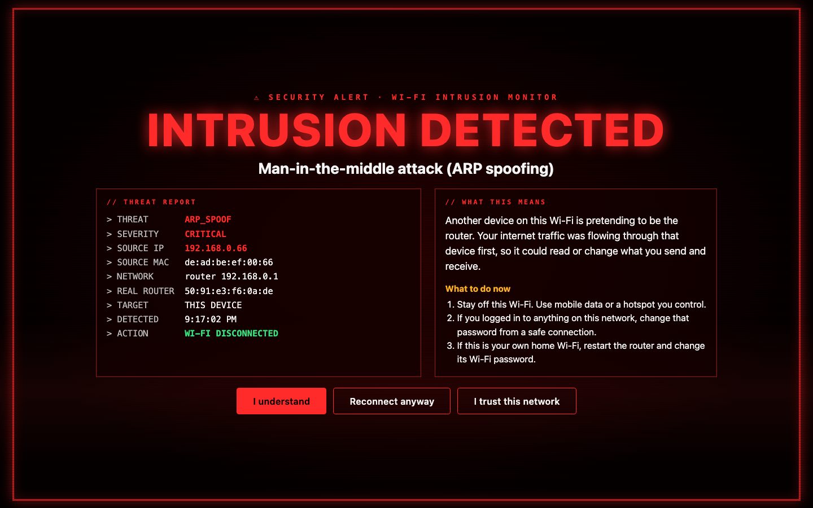

# Wi-Fi Intrusion Monitor

An app for macOS (menu bar) and Windows (system tray) that watches the Wi-Fi you are connected to. When someone on that network attacks your laptop, it disconnects you from the Wi-Fi and fills your screen with an alert that says what happened, who did it and what to do next.

It works on any Wi-Fi: a café, a hotel, an airport, or your own home.



## What it detects

| Attack | What the attacker is doing | How the app catches it |
|---|---|---|
| **Man-in-the-middle (ARP spoofing)** | Pretends to be the router so all your traffic passes through their device | The router's hardware address changes while you are still on the same network |
| **DNS hijacking** | Sends you to a fake copy of a website when you type the real name | Checks the Wi-Fi's answers for addresses that never change, and checks bank and login sites against Cloudflare's encrypted DNS |
| **HTTPS interception** | Swaps website security certificates so they can read encrypted traffic | An encrypted request to a known server fails certificate checks |
| **Port scanning** | Probes your laptop for a way in | Decoy ports (Telnet, Remote Desktop, database ports) that no honest device ever connects to |
| **Evil twin hotspot** | Copies the name of a network you trust, with weaker security | The same Wi-Fi name shows up with weaker security than before (needs Location access, see below) |

### Severity

- **Critical:** Wi-Fi is turned off and the full-screen alert appears.
- **Warning:** a notification, and the menu-bar dot turns amber. This covers events that are suspicious but can also be innocent, such as your router itself probing devices.

### What it cannot do

It sees attacks aimed at **your laptop**. It cannot see what other people's devices are doing to each other, and it is not antivirus. It does not inspect the content of your traffic and it sends nothing anywhere.

## Install

1. Download the `.dmg` from [ayoadeabel.tech/wifi-intrusion-monitor](https://ayoadeabel.tech/wifi-intrusion-monitor).
2. Open it and drag **Wi-Fi Intrusion Monitor** into **Applications**.
3. Open the app. macOS will block it the first time because it is not from the App Store. Go to **System Settings → Privacy & Security**, scroll down, and click **Open Anyway**.
4. If your firewall is on, macOS asks whether the app may accept incoming connections. Click **Allow**. Without this the decoy ports cannot see scans.
5. Optional: from the menu, choose **Show Wi-Fi names** and allow Location access. macOS hides Wi-Fi names from apps without it, and the evil-twin check needs the name. The app never reads your location.

A coloured dot appears in the menu bar: 🟢 watching, 🟠 recent warning, 🔴 alert showing, ⚪️ paused.

### Windows

1. Download `WiFi-Intrusion-Monitor-windows.exe`, move it somewhere it can stay (for example Documents), and double-click it. There is no installer.
2. SmartScreen may say **Windows protected your PC** because the app is not signed. Click **More info → Run anyway**.
3. Windows Firewall asks whether to allow the app. Tick **Private** and **Public** and click **Allow** (needs an administrator password). Airport and hotel Wi-Fi are Public networks.
4. Optional: **Settings → Privacy & security → Location → Let desktop apps access your location**. Windows 11 hides Wi-Fi names without it, and the evil-twin check needs the name.

A shield with a coloured dot appears in the system tray. Right-click it for the menu.

## Menu

- **Disconnect automatically when attacked:** on by default. Turn it off to get the alert without losing Wi-Fi.
- **Trust this network:** for networks that inspect traffic on purpose, such as some workplaces. Alerts still show, but Wi-Fi stays on.
- **Recent alerts** and **Open alert log:** every event is saved to `~/Library/Application Support/Wi-Fi Intrusion Monitor/events.jsonl`.
- **Show a test alert:** see the alert without any attack.
- **Start at login.**

## Test it against a real attack

Use your own network and your own devices only.

- **Port scan:** from another computer on the same Wi-Fi, run `nmap -p 21,23,3389 <your-mac-ip>`, or on Windows PowerShell run `Test-NetConnection <your-mac-ip> -Port 23` then `-Port 3389`. One port gives a warning. Two ports give the full alert.
- **ARP spoofing:** from a Linux machine (Kali works), run `sudo arpspoof -i wlan0 -t <your-mac-ip> <router-ip>`. The alert appears within a few seconds.

## Run from source

```bash
python3 -m venv .venv
.venv/bin/pip install -r requirements.txt
WIMON_DRY_RUN=1 .venv/bin/python -m wimon            # alerts without turning Wi-Fi off
.venv/bin/python -m wimon --demo-alert               # opens the alert after start-up
.venv/bin/python -m pytest                           # simulated attacks against the detectors
./build_mac.sh                                       # builds the .app and .dmg into dist/
```

Python 3.10+ is required. The build uses the python.org installer's universal Python, so the app runs on Intel and Apple Silicon Macs.

**Windows build:** install Python 3.10+ from python.org, then double-click `build_windows.bat`. It creates a virtual environment, runs the tests, builds a single `.exe` with PyInstaller, and copies it into the website folder as `WiFi-Intrusion-Monitor-windows.exe`. A Windows `.exe` can only be built on Windows.

## How it is built

```
wimon/
  engine.py           monitoring loop, baselines, de-duplication
  detectors/          one file per attack: arp, dns, honeypot (port scans), evil_twin
  controller.py       what happens on an alert: disconnect, trust, reconnect, watchdog
  report.py           what the alert says
  alert.html          the full-screen alert page, shared by both systems
  platform_macos.py   router, ARP table, DHCP lease, Wi-Fi on/off (macOS)
  alert.py, app.py    WebKit alert window and menu-bar app (macOS)
  platform_windows.py PowerShell/arp/route/netsh queries, netsh disconnect (Windows)
  alert_windows.py, app_windows.py   pywebview alert window and tray app (Windows)
```

Everything above the platform files is shared. Windows rejoins known networks by itself, so while an alert is open the controller's watchdog disconnects again if that happens.

## Mobile

Phones are harder. iOS does not let apps read the network or switch Wi-Fi off. Android allows part of it through a local VPN. If you want to work on a mobile version, get in touch through [ayoadeabel.tech](https://ayoadeabel.tech).

## Licence

MIT
